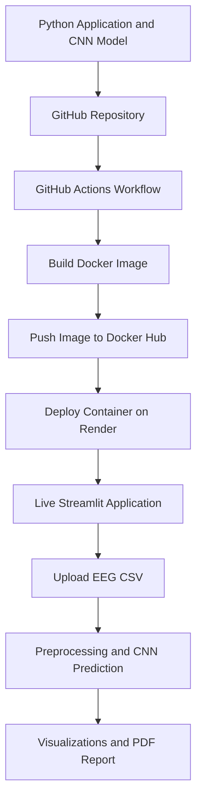

# 🧠 NeuroSense — EEG Classification with Deep Learning

**An experimental EEG classification application powered by TensorFlow, CNN, Streamlit, Docker, and CI/CD automation.**

[](https://www.python.org/)
[](https://www.tensorflow.org/)
[](https://streamlit.io/)
[](https://www.docker.com/)
[](https://github.com/features/actions)

## 🌐 Live Demo

**Try NeuroSense online:** [Open the deployed application](YOUR_RENDER_URL_HERE)

> Replace `YOUR_RENDER_URL_HERE` with your actual Render service URL.

## 📌 Project Overview

NeuroSense is a web-based EEG classification project that integrates deep learning with an interactive interface for exploring EEG data and generating model predictions.

Built using Python, TensorFlow, and Streamlit, the application supports CSV data uploads, EEG waveform visualization, classification predictions, and PDF report generation. The project also demonstrates an end-to-end deployment workflow using Docker, Docker Hub, GitHub Actions, and Render.

## ✨ Key Features

- **EEG Data Upload:** Upload EEG data in CSV format.
- **Deep Learning:** Use a trained CNN model for experimental EEG classification.
- **Signal Visualization:** Explore EEG waveforms through interactive visualizations.
- **Prediction Interface:** View classification outputs from the trained model.
- **PDF Reports:** Generate reports from the application.
- **Containerization:** Package the application and its dependencies using Docker.
- **CI/CD Automation:** Build and publish Docker images through GitHub Actions.
- **Cloud Deployment:** Run the containerized application on Render.

## 🛠️ Tech Stack

| Category | Technologies |
|---|---|
| Programming | Python |
| Machine Learning | TensorFlow, CNN |
| Data Processing | NumPy, Pandas |
| Visualization and UI | Streamlit |
| Model Storage | Keras model, NumPy preprocessing artifacts, JSON class labels |
| Containerization | Docker |
| CI/CD | GitHub Actions |
| Image Registry | Docker Hub |
| Cloud Hosting | Render |
| Version Control | Git, GitHub |

## 🏗️ MLOps Architecture



### Deployment Workflow

1. **Version Control:** Store the application code and deployment configuration in GitHub.
2. **Continuous Integration:** Trigger GitHub Actions when changes are pushed to the `main` branch.
3. **Container Build:** Build the Docker image from the repository's Dockerfile.
4. **Image Publishing:** Push the versioned image to Docker Hub.
5. **Cloud Deployment:** Run the container using Render.
6. **Application Access:** Access the deployed Streamlit interface through a public URL.

**Docker Hub image:** [`amruthas16/neurosense`](https://hub.docker.com/r/amruthas16/neurosense)

**GitHub repository:** [NeuroSense](https://github.com/amrutha-s16/NeuroSense)

> Note: The current Render service uses a prebuilt Docker image. Image updates may require a manual redeployment unless automatic deployment is configured.

## 📂 Project Structure

```text
NeuroSense/
├── .github/
│   └── workflows/
│       └── docker-build.yml
├── models/
│   ├── neurosense_cnn.keras
│   ├── neurosense_preprocessing.npz
│   └── class_names.json
├── app.py
├── Dockerfile
├── .dockerignore
├── .gitignore
├── requirements.txt
└── README.md
```

*The structure above shows the main application and deployment files; your repository may contain additional files.*

## 🚀 Run Locally

### 1. Clone the repository

```bash
git clone https://github.com/amrutha-s16/NeuroSense.git
cd NeuroSense
```

### 2. Create and activate a virtual environment

```bash
python -m venv venv
```

Windows:

```bash
venv\Scripts\activate
```

### 3. Install dependencies

```bash
pip install -r requirements.txt
```

### 4. Start the application

```bash
streamlit run app.py
```

Open the local URL displayed in your terminal, usually `http://localhost:8501`.

## 🐳 Run with Docker

Pull the published image:

```bash
docker pull amruthas16/neurosense:latest
```

Run the container:

```bash
docker run --rm -p 8501:10000 amruthas16/neurosense:latest
```

Open `http://localhost:8501` in your browser.

## 🔄 CI/CD Configuration

The GitHub Actions workflow is located at:

`.github/workflows/docker-build.yml`

The workflow runs on pushes to the `main` branch and supports manual execution. It builds the Docker image and publishes the `latest` and `1.0` tags to Docker Hub using GitHub repository secrets.

Required GitHub Actions secrets:

- `DOCKERHUB_USERNAME`
- `DOCKERHUB_TOKEN`

Credentials are stored as GitHub secrets rather than hard-coded in the workflow.

## 🔮 Future Improvements

- Improve classification performance through systematic model evaluation and data-quality checks.
- Add class-wise precision, recall, F1-score, and confusion-matrix analysis.
- Introduce automated model and data validation.
- Add model versioning and experiment tracking.
- Configure automatic redeployment after successful image publishing.
- Add application monitoring and structured error logging.
- Strengthen input validation and automated testing.

## ⚠️ Disclaimer

NeuroSense is an experimental machine learning project intended for educational and research purposes. Its predictions are not clinically validated and must not be used to diagnose, treat, or make medical decisions about neurological conditions.

## 👩‍💻 Author

**Amrutha S Kumar**

Data Science | Machine Learning | Deep Learning | Python | MLOps

- GitHub: [@amrutha-s16](https://github.com/amrutha-s16)

