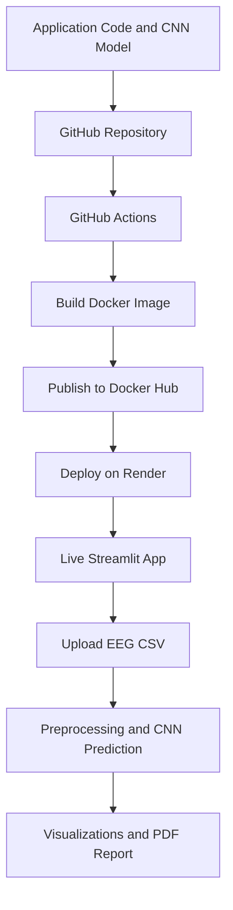

# 🧠 NeuroSense — EEG Classification with Deep Learning

**An experimental EEG classification application built with TensorFlow, CNN, Streamlit, Docker, and CI/CD automation.**

[](https://www.python.org/)
[](https://www.tensorflow.org/)
[](https://streamlit.io/)
[](https://www.docker.com/)
[](https://github.com/features/actions)

## 🌐 Live Demo

**🚀 [Launch NeuroSense](https://neurosense-eeg.onrender.com/)**

- **GitHub Repository:** [NeuroSense](https://github.com/amrutha-s16/NeuroSense)
- **Docker Hub:** [amruthas16/neurosense](https://hub.docker.com/r/amruthas16/neurosense)

## 📌 Project Overview

NeuroSense is a web-based EEG classification project that combines deep learning with an interactive interface for exploring EEG data and generating model predictions.

Built using Python, TensorFlow, and Streamlit, the application supports CSV uploads, EEG waveform visualization, classification predictions, and PDF report generation. The project demonstrates a deployment workflow using Docker, Docker Hub, GitHub Actions, and Render.

## ✨ Key Features

- **EEG Data Upload:** Upload EEG data in CSV format.
- **Deep Learning:** Apply a trained CNN model for experimental EEG classification.
- **Signal Visualization:** Explore EEG waveforms through visualizations.
- **Prediction Interface:** View classification outputs from the trained model.
- **PDF Reports:** Generate reports through the application.
- **Docker Containerization:** Package the application and its dependencies.
- **CI/CD Automation:** Build and publish Docker images using GitHub Actions.
- **Cloud Deployment:** Host the containerized application on Render.

## 🛠️ Tech Stack

| Category | Technologies |
|---|---|
| Programming | Python |
| Deep Learning | TensorFlow, CNN |
| Data Processing | NumPy, Pandas |
| Web Interface | Streamlit |
| Model Artifacts | Keras, NumPy, JSON |
| Containerization | Docker |
| CI/CD | GitHub Actions |
| Container Registry | Docker Hub |
| Cloud Hosting | Render |
| Version Control | Git, GitHub |

## 🏗️ MLOps Architecture



### Deployment Workflow

1. **Version Control:** Maintain application code and configuration in GitHub.
2. **Continuous Integration:** Trigger the GitHub Actions workflow when code is pushed to `main`.
3. **Containerization:** Build a Docker image using the project Dockerfile.
4. **Image Publishing:** Publish the image to Docker Hub with version tags.
5. **Cloud Deployment:** Run the containerized application on Render.
6. **Application Access:** Use the public URL to access the Streamlit interface.

## 📂 Project Structure

```text
NeuroSense/
├── .github/
│   └── workflows/
│       └── docker-build.yml
├── models/
│   ├── neurosense_cnn.keras
│   ├── neurosense_preprocessing.npz
│   └── class_names.json
├── app.py
├── Dockerfile
├── .dockerignore
├── .gitignore
├── requirements.txt
└── README.md
```

## 🚀 Run Locally

### 1. Clone the repository

```bash
git clone https://github.com/amrutha-s16/NeuroSense.git
cd NeuroSense
```

### 2. Create a virtual environment

```bash
python -m venv venv
```

Activate it on Windows:

```bash
venv\Scripts\activate
```

### 3. Install dependencies

```bash
pip install -r requirements.txt
```

### 4. Run the application

```bash
streamlit run app.py
```

Open the local URL displayed in your terminal, usually `http://localhost:8501`.

## 🐳 Run with Docker

Pull the published image:

```bash
docker pull amruthas16/neurosense:latest
```

Run the container:

```bash
docker run --rm -p 8501:10000 amruthas16/neurosense:latest
```

Then open `http://localhost:8501` in your browser.

## 🔄 CI/CD Pipeline

The workflow is configured in `.github/workflows/docker-build.yml`.

It runs on pushes to the `main` branch and supports manual execution. It builds the Docker image and publishes the `latest` and `1.0` tags to Docker Hub.

Required GitHub repository secrets:

- `DOCKERHUB_USERNAME`
- `DOCKERHUB_TOKEN`

Credentials are stored as GitHub secrets rather than hard-coded into the workflow.

**Note:** The current Render service uses a prebuilt Docker image. New images may require a manual redeployment unless automatic deployment is configured.

## 🔮 Future Improvements

- Improve classification performance through systematic model evaluation.
- Add class-wise precision, recall, F1-score, and confusion-matrix analysis.
- Implement automated data validation and model testing.
- Add experiment tracking and model versioning.
- Configure automated redeployment after successful image publishing.
- Add application monitoring and structured error logging.

## ⚠️ Disclaimer

NeuroSense is an experimental project for educational and research purposes. Its predictions are not clinically validated and must not be used to diagnose, treat, or make medical decisions about neurological conditions.

## 👩‍💻 Author

**Amrutha S Kumar**

Data Science | Machine Learning | Deep Learning | Python | MLOps

- GitHub: [@amrutha-s16](https://github.com/amrutha-s16)
- Live Project: [NeuroSense EEG Classification](https://neurosense-eeg.onrender.com/)
